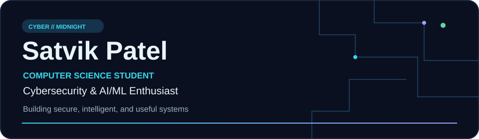
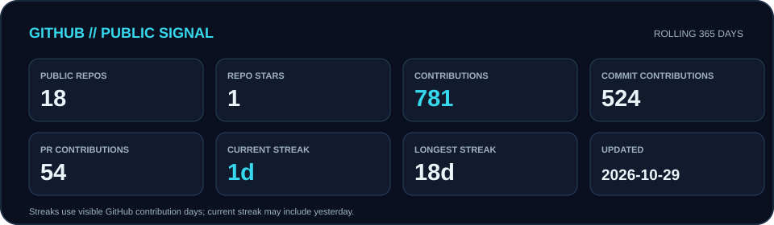
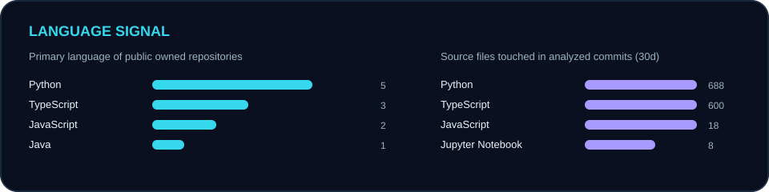
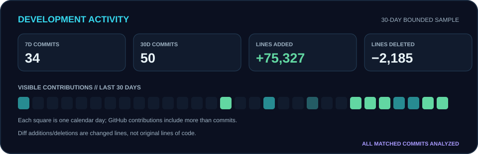

I’m a BS (Hons) Computer Science student at Ahmedabad University. I’m interested in cybersecurity, applied AI/ML, and building software that solves practical problems. My public work ranges from secure agent systems and phishing detection research to full-stack tools and coursework. I’m still learning, testing ideas, and refining how I build.

### What I work with

| Area | Technologies seen in my public projects |
| :--- | :--- |
| Languages | Python, Java, JavaScript, TypeScript, SQL |
| Development | React, Express, FastAPI, PostgreSQL, SQLite, Git, GitHub |
| AI / ML | Python notebooks, small language model research, phishing classification |
| Security | Browser-agent safeguards, privacy-aware systems, phishing detection |

<!-- PROFILE:GENERATED:START -->
### Live GitHub signal

### Development activity

**Recently active public repositories:** [Microsoft-Game-Developer-Hackathon-2026/Pulse-Xi](https://github.com/Microsoft-Game-Developer-Hackathon-2026/Pulse-Xi), [satvikp-coder/phishing-slm-research](https://github.com/satvikp-coder/phishing-slm-research), [satvikp-coder/CSC360-AU2520039](https://github.com/satvikp-coder/CSC360-AU2520039), [satvikp-coder/demo-group7](https://github.com/satvikp-coder/demo-group7)

### Selected work

**[sentinel](https://github.com/satvikp-coder/sentinel)** — Security controls and monitoring for autonomous browser agents. · Python

**[demo-group7](https://github.com/satvikp-coder/demo-group7)** — Heritage trip planning with a React client and Express/PostgreSQL backend. · TypeScript

**[phishing-slm-research](https://github.com/satvikp-coder/phishing-slm-research)** — A research plan comparing small language model approaches to phishing email detection. · Python

**[Ras](https://github.com/satvikp-coder/Ras)** — Local competition operations with inventory, transactions, and SQLite ledgers. · JavaScript

**[Amdavad-online](https://github.com/satvikp-coder/Amdavad-online)** — An Ahmedabad-inspired browser game at its documented foundation stage. · TypeScript

**[CSC360-AU2520039](https://github.com/satvikp-coder/CSC360-AU2520039)** — Java graphics coursework and experiments. · Java

### Recent public activity

- 2026-10-27 · Pushed code in [Microsoft-Game-Developer-Hackathon-2026/Pulse-Xi](https://github.com/Microsoft-Game-Developer-Hackathon-2026/Pulse-Xi)
- 2026-10-27 · Pushed code in [satvikp-coder/CSC360-AU2520039](https://github.com/satvikp-coder/CSC360-AU2520039)
- 2026-10-26 · Opened a pull request in [Microsoft-Game-Developer-Hackathon-2026/Pulse-Xi](https://github.com/Microsoft-Game-Developer-Hackathon-2026/Pulse-Xi)
- 2026-10-26 · Merged a pull request in [Microsoft-Game-Developer-Hackathon-2026/Pulse-Xi](https://github.com/Microsoft-Game-Developer-Hackathon-2026/Pulse-Xi)
- 2026-10-24 · Pushed code in [satvikp-coder/phishing-slm-research](https://github.com/satvikp-coder/phishing-slm-research)

Updated 2026-10-29 UTC · Public GitHub data · See [metric definitions](docs/SETUP.md#metric-definitions).
<!-- PROFILE:GENERATED:END -->

### Currently exploring

Cybersecurity · Applied AI/ML · Secure systems · Software engineering · Technical research

<a href="https://github.com/satvikp-coder">GitHub</a>

