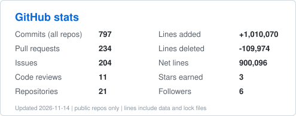
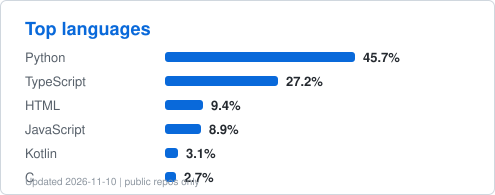
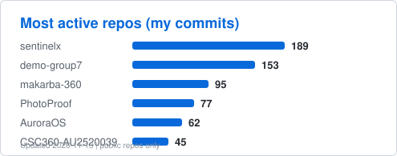

# Hi, I'm Satvik Patel

CS student building tools to keep people safe online, and learning research.

## About me

- BS (Hons) Computer Science at Ahmedabad University (admitted 2025), based in Ahmedabad.
- I am interested in AI/ML security, trustworthy AI, and scam and phishing detection. I am also learning cloud (AWS).
- Now: research on phishing detection with small language models, and a perovskite solar cell dashboard.
- Reach me: [LinkedIn](https://www.linkedin.com/in/satvik-hitesh-patel-65b9b428a/) | University email: satvik.p@ahduni.edu.in | Personal: satvikb0301@gmail.com

## What I work with

**Core**

**Also work with**

-232F3E?style=flat-square&logo=amazonwebservices&logoColor=white)

## Research

1. [phishing-slm-research](https://github.com/satvikp-coder/phishing-slm-research): do small language models detect phishing email well? Supervisor: Prof. Amit Das. In progress. Test set still locked.
2. [perovskite-pce-dashboard](https://github.com/satvikp-coder/perovskite-pce-dashboard): ML screening dashboard for perovskite solar cell efficiency. Supervisor: Mayuribala Mangrulkar. Blocked-split R² is 0.457, random split 0.623. [Live demo](https://perovskite-pce-dashboard.onrender.com).
3. Admission-to-placement data mining study (summer 2026). No public repo. Analyses admission data to see how student selection can be made better, and links it to placement outcomes.

## Featured projects

1. [sentinelx](https://github.com/satvikp-coder/sentinelx): verification-first guards for AI agents and authorized lab sites (Meta AI Hackathon). `Python`
2. [sentinel](https://github.com/satvikp-coder/sentinel): security layer and dashboard for autonomous browser agents (HACK IITK 2026 Finalist). `Python`
3. [phishing-slm-research](https://github.com/satvikp-coder/phishing-slm-research): phishing email detection with small language models vs. classical baselines. `Python`
4. [perovskite-pce-dashboard](https://github.com/satvikp-coder/perovskite-pce-dashboard): predicts perovskite solar cell efficiency and a stability proxy. `Python`
5. [scamlens](https://github.com/satvikp-coder/scamlens): explainable, privacy-first scam checker for messages and links; live on Google Play. `TypeScript`
6. [PhotoProof](https://github.com/satvikp-coder/PhotoProof): framework for image forgery detection. Foundation stage: the pipeline works, detectors are not built yet. `Python`

More: [AuroraOS](https://github.com/satvikp-coder/AuroraOS) (early-stage ARM64 OS kernel, `C`) | [smart-trolley-os](https://github.com/satvikp-coder/smart-trolley-os) (Android travel-assistance launcher with offline maps, built on the open-source Dashline base, `Kotlin`) | [CyberX](https://github.com/satvikp-coder/CyberX) (phishing website detector, IBM Z Datathon 2025, `Python`)

## Apps on Google Play

- [ScamLens](https://play.google.com/store/apps/details?id=in.satvikpatel.scamlens): checks messages and links for scams. Works in English, Hindi and Gujarati. [Source code](https://github.com/satvikp-coder/scamlens).
- [Cyber Safe India](https://play.google.com/store/apps/details?id=com.satvik.CyberSafeIndia): Android app with daily security tips, scam alerts, emergency numbers and quizzes to teach cyber safety.

## Hackathons

- HACK IITK 2026: Finalist (Sentinel)
- Meta AI Hackathon (Sentinel X)
- Ingenious Hackathon 7.0 (Identity Hub)
- IBM Z Datathon 2025 (CyberX)
- Odoo Hackathon 2026

## GitHub stats

  
  

  
  

Cards are built every hour from the GitHub API by a workflow in this repo. They count public repos I own (not forks). Line counts include data and lock files. Top languages leave out Jupyter Notebook.

---

<a href="https://www.linkedin.com/in/satvik-hitesh-patel-65b9b428a/">LinkedIn</a>

